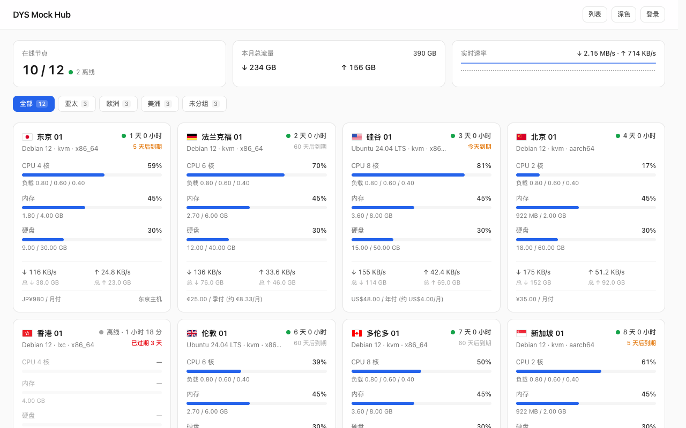

# Monitor-DYS

面向 [Monitor](https://github.com/monitor-probe/monitor) 的紧凑型状态主题。**v2.0** 带来全新的浅色总览、地区统计和节点详情，基于 **Svelte 5 (runes) + Vite + Tailwind CSS v4 + uPlot** 构建。



部分数据格式化与实时流逻辑参考并移植自官方默认主题 `monitor-theme-default`（MIT License, Copyright (c) 2026 stqfdyr）。

## 特性

- **首页总览**：四块面板展示服务器状态、实时吞吐、平均 CPU 和本期流量。状态色块区分在线、告警与离线；吞吐和 CPU 折线随实时数据更新。
- **世界地图与地区统计**：点阵地图按地区节点数着色，悬停可看在线/总数、上下行速率和平均延迟。点击地图标记或地区列表可筛选节点；手机端以地区列表为主。
- **节点卡片与列表**：卡片展示 CPU、内存、磁盘与流量指标，附最近负载趋势、速率、当期流量和到期信息。开启 Ping 后，卡片显示最多三个探针的延迟和丢包，以及最近 12 段色条；列表显示平均值。支持紧凑和标准卡片尺寸。
- **节点详情**：查看资源趋势、Ping 延迟与丢包、硬件与系统、流量与费用；支持选择时间范围、查看峰值和筛选探针。点击探针标签切换，Alt/⌥ 点击或双击可仅看一个探针，「全部」恢复显示。
- **只提供浅色模式**：在后台「主题色」填写任意十六进制色值（如 `#3b82f6`）。主题色用于选中态、指标条、趋势线和地图；按钮与文字使用自动加深的版本以保证对比度，在线、告警、危险与离线状态色保持不变。刷新时使用上次缓存的颜色，首次访问会等待设置读取后再显示，不会闪色。
- **可分享的筛选**：分组、地区、搜索和排序保存在 URL 的 `g`、`c`、`q`、`sort` 参数里。首页按 `/` 聚焦搜索、按 `Esc` 清空；详情页按 `←` / `→` 沿筛选顺序切换，返回首页时恢复滚动位置。
- **大量节点与快速首屏**：身份、节点与配置并行读取；大量节点分批渲染，离屏卡片冻结更新。再次访问时可先显示近期公开节点快照；详情页及图表按需加载。
- **访客信息与后台入口**：可选的访客气泡显示出口地区、浏览器与设备信息。公开页仅对已登录管理员显示后台入口；状态页不公开时显示登录提示。

## 体积与性能

以下为 v2.0 的[基准测量](docs/perf/current.json)。JS 体积为 gzip（1 KB = 1,000 字节）；交互指标取 Chromium、1440 × 900 下 500 节点场景的三次运行中位数。

| 指标 | 实测 |
|---|---:|
| 入口 JS | 41.7 KB |
| 首屏 JS（含地图） | 59.8 KB |
| 详情 JS | 30.0 KB |
| 首张卡片出现 | 73 ms |
| 500 节点运行 60 秒后的 JS 堆 | 8.2 MiB |
| 单张卡片后代元素 | 79 个 |

## 隐私与外部请求说明

主题主要请求同源 Hub 接口（`/api/*`）。唯一的外部查询是可关闭的访客定位。

1. **底部访客气泡（`visitor_info_enabled`，默认 `true`）**：成功加载站点配置并确认开启后，等待浏览器空闲再查询。
   - 开启时，浏览器向 `https://api.ip.sb/geoip` 请求出口 IP 与地理定位（5 秒超时）；若失败则回退请求 `https://ipwho.is/`，结果缓存至当前会话 `sessionStorage`。
   - 将 `visitor_info_enabled` 设为 `false` 后，**不会渲染气泡，也不会向 `api.ip.sb` 或 `ipwho.is` 发出任何请求**。
2. **点阵世界地图**：地图数据在构建期由 `npm run gen:map` 预生成并打包在 `src/lib/map-data.ts` 中，**运行时无任何外部地图或瓦片请求**。

## 安装方式

在 Monitor 管理面板中进入 **「主题 → 从 GitHub 安装」**，填入仓库地址：

```text
https://github.com/dingding229/Monitor-DYS
```

或者下载 Release 中的 `theme.tar.gz`，解压到 Hub 的 `--themes` 目录下 `dys/` 子目录。

## 更新

在管理面板 **「主题」** 页面中，找到已安装的 **DYS** 主题，点击 **「从 GitHub 更新」**（或重新填入 `https://github.com/dingding229/Monitor-DYS` 安装最新 Release），无需重启 Hub 即可生效。仍受支持的主题设置会保留。

## 主题设置（`theme.json`）

站长可在后台「主题 → 设置」中调整以下参数（未保存或旧版 Hub 不支持时自动使用默认值）。从旧版升级时，`theme`（v2.0.0 的预设）、`accent` 和 `color_scheme` 已移除，旧值会被忽略；请在「主题色」重新填写颜色。

| 键名 | 类型 | 默认值 | 说明 |
|---|---|---|---|
| `layout` | `select` | `"grid"` | 默认布局：`"grid"`（卡片）或 `"table"`（列表）；访客可在页面切换并保存在浏览器 `localStorage` |
| `card_size` | `select` | `"compact"` | 卡片尺寸：`"compact"`（紧凑）或 `"standard"`（标准） |
| `accent_color` | `string` | `"#10b981"` | 主题色，十六进制 `#rgb` 或 `#rrggbb`；无效值回退 `#10b981` |
| `show_summary` | `boolean` | `true` | 显示首页的状态、吞吐、CPU 和流量总览 |
| `show_ping` | `boolean` | `true` | 卡片底部显示最多三个探针的读数，以及最近 12 段延迟和丢包色条；列表显示平均值。关闭后首页和详情页均不请求 Ping。首页仅在空闲时读取视口附近的在线节点，每分钟更新，并发最多 3 个。 |
| `show_map` | `boolean` | `true` | 显示首页点阵世界地图及地区统计 |
| `show_search` | `boolean` | `true` | 显示搜索框 |
| `show_sort` | `boolean` | `true` | 显示排序下拉选择 |
| `announcement` | `text` | `""` | 顶部公告（纯文本渲染，保留换行） |
| `show_billing` | `boolean` | `true` | 显示节点录入价格（到期状态独立显示） |
| `expiry_warning_days` | `number` | `7` | 到期提醒天数（`1–365`） |
| `visitor_info_enabled` | `boolean` | `true` | 显示底部访客气泡（关闭后不向 `api.ip.sb` 或 `ipwho.is` 发任何请求） |
| `footer` | `string` | `""` | 页脚文字 / 备案号 |
| `footer_url` | `string` | `""` | 页脚链接（仅接受 `http/https` 地址，无效时仅显示文字） |
| `poll_interval` | `number` | `5` | WebSocket 不可用时降级轮询 `/api/nodes` 的间隔（`2–60` 秒） |

## 路由与反代 / WAF 白名单

本主题使用 HTML5 History 路由：

- `/`：节点总览首页
- `/node/{id}`：节点历史详情页（支持直接刷新与分享链接）

Hub 会将未知路径回退到主题的 `dist/index.html`（不会占用 `/admin`、`/api`、`/install.sh`、`/agent/*`）。
**注意**：如果 Hub 前方部署了按路径做正向白名单的反向代理、CDN 或 WAF，请务必放行以下路径，否则从首页点进详情页正常（`pushState`），直接刷新 `/node/{id}` 或加载图标时会被拦截：

- `/node/*`
- `/favicon.svg`
- `/apple-touch-icon.png`

## 本地开发

```bash
npm ci

# 连接任意开启公开状态页的真实 Hub 或本地 Mock Hub（默认 http://127.0.0.1:9911）
MONITOR_HUB=http://127.0.0.1:9911 npm run dev
```

### 常用命令

- `npm run dev`：启动 Vite 开发服务器（自动代理 `/api` 与 `/api/ws`）
- `npm run gen:map`：从 `world-atlas` (Natural Earth 110m) 重新生成 `src/lib/map-data.ts`
- `npm run check`：运行 `svelte-check` 与 TypeScript 类型检查
- `npm run build`：构建生产包至 `dist/`
- `node scripts/check-size.mjs`：检查构建资产的 gzip 体积（v2 入口 / 首屏 / 详情 JS 分别为 42 / 60 / 30 KB，CSS 总量 ≤ 8.936 KB）。本地和 GitHub Actions 默认使用 v2；如需手动验证旧 JS 预算，可指定 `SIZE_BUDGET=v1`。
- `npm test`：运行 Vitest 单元测试
- `npm run test:e2e`：运行 Playwright 端到端测试

## 发版

1. 确保 `theme.json`、`package.json`、`package-lock.json` 三者的 `version` 完全一致。
2. 本地执行完整检查、测试与打包验证：
   ```bash
   npm run check && npm test && npm run build && node scripts/check-size.mjs && npm run test:e2e
   bash scripts/pack.sh && node scripts/verify-package.mjs
   ```
3. 推送与版本号一致的 Git 标签 `v<version>` 触发 `.github/workflows/release.yml`，自动构建、校验并发布包含 `theme.tar.gz` 与 `theme.tar.gz.sha256` 的正式版 GitHub Release。

## 许可

MIT
